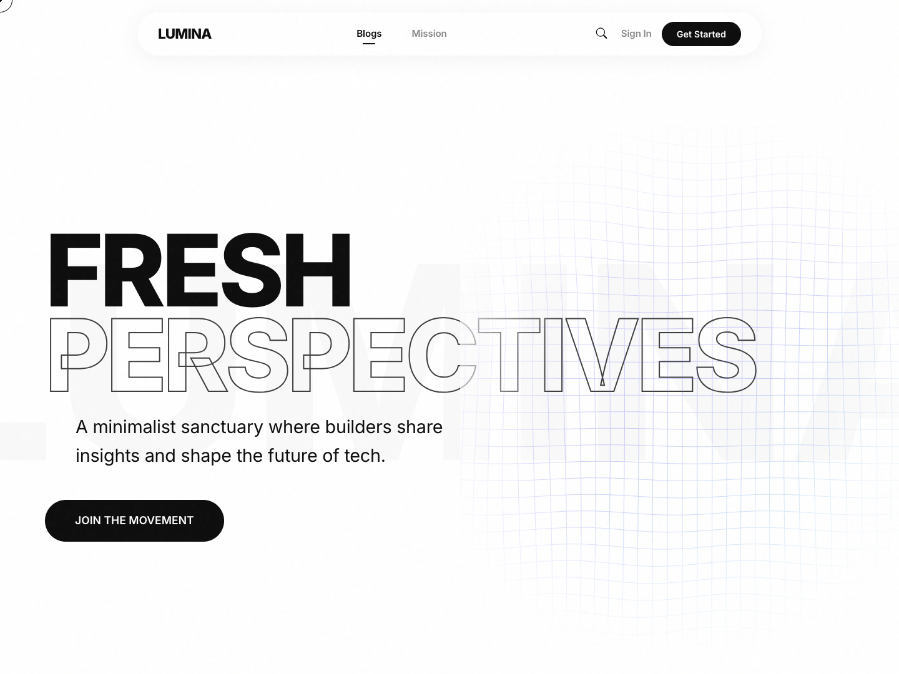
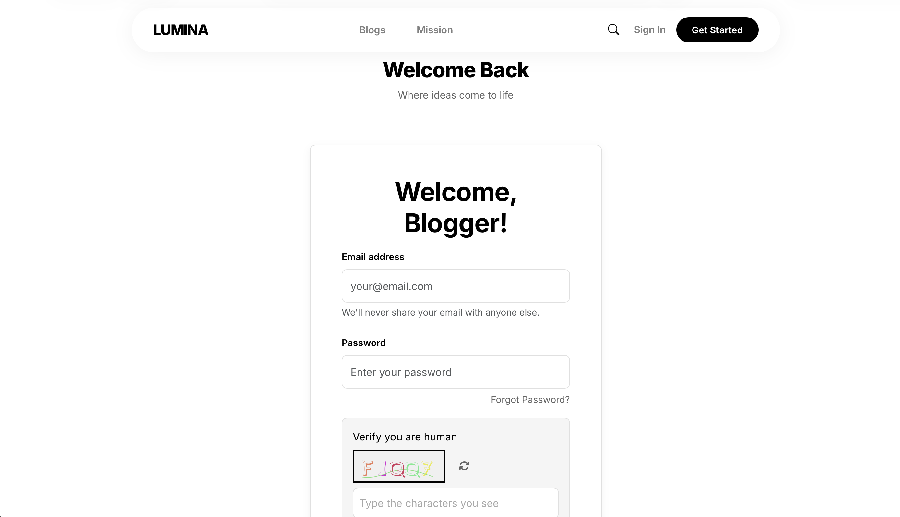
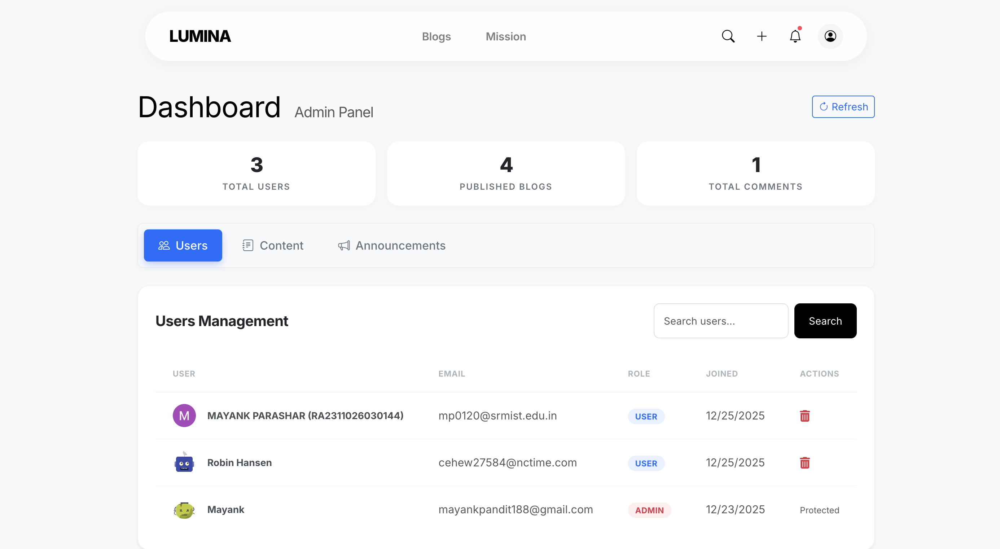
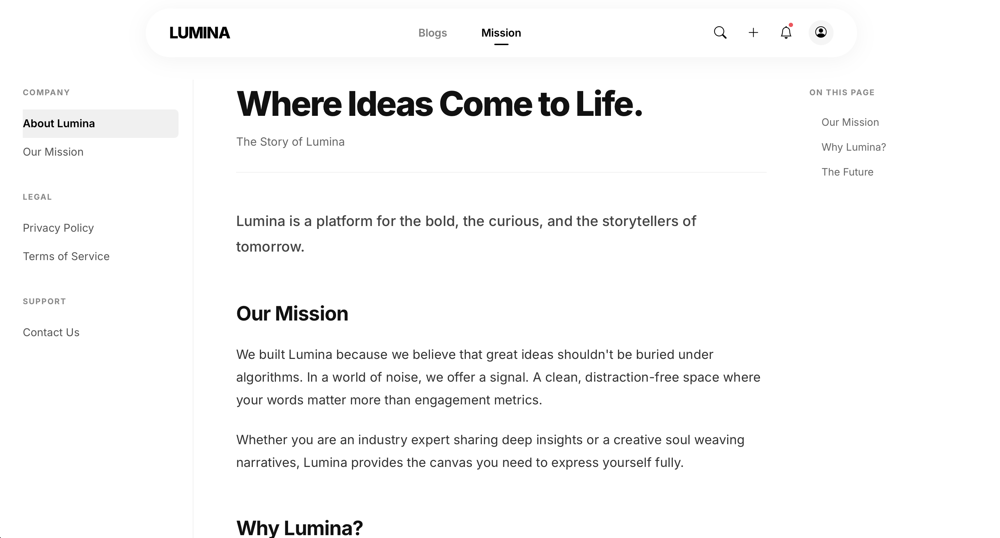
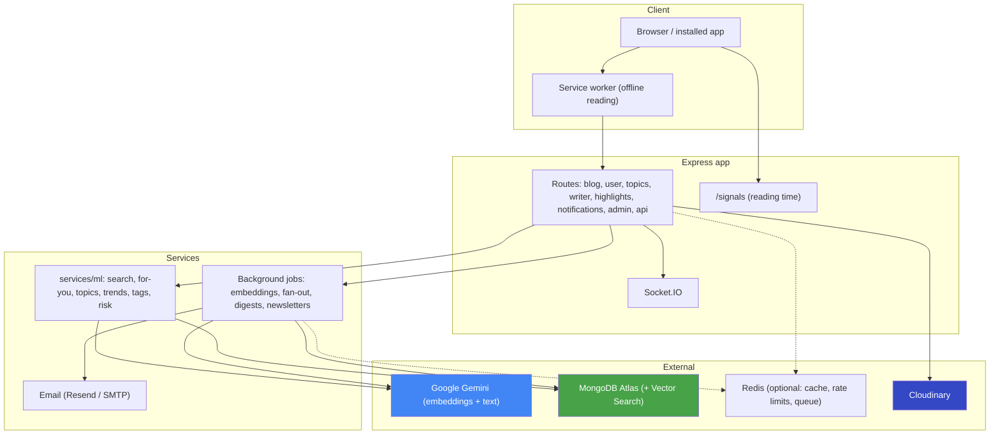
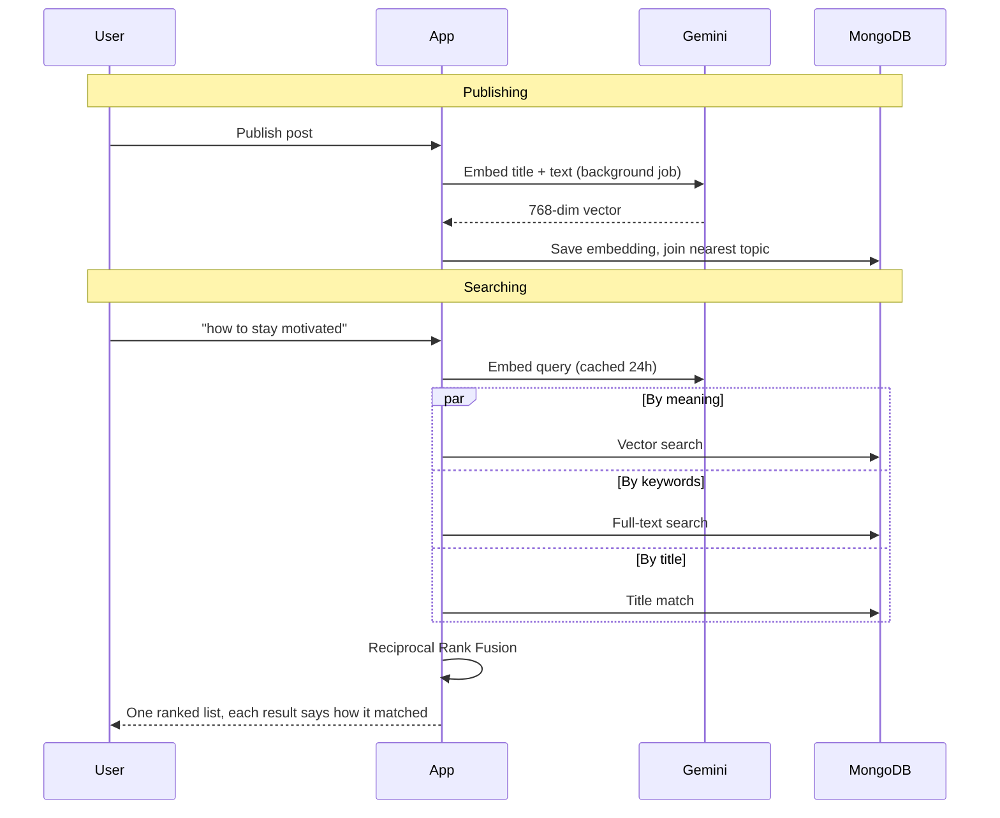

<div align="center">

# Lumina

### **Learning-Powered Blogging and Intelligent Retrieval**

[](https://nodejs.org/)
[](https://www.mongodb.com/)
[](https://ai.google.dev/)
[](#license)

**A full-stack blogging platform with hybrid semantic search, a feed that learns from how you read, automatic topics, writing tools for authors, and real-time notifications.**

[Live Site](https://llumina.online/) | [Features](#features) | [Quick Start](#quick-start) | [Report a Bug](https://github.com/MayankParashar28/Lumina/issues)

</div>

---

## Screenshots

<div align="center">

| **Landing & Home** | **Feed & Content** |
|:---:|:---:|
|  |  |
| **Modern Landing Page** | **Infinite Scroll Feed** |

| **Authentication** | **Admin Dashboard** |
|:---:|:---:|
|  |  |
| **Sign In / Sign Up** | **Analytics & Management** |

| **Engagement** | **Documentation** |
|:---:|:---:|
|  |  |
| **Comments & Smart Recommendations** | **Project Docs** |

</div>

---

## Table of Contents

- [Features](#features)
- [How the Machine Learning Works](#how-the-machine-learning-works)
- [System Architecture](#system-architecture)
- [Tech Stack](#tech-stack)
- [Quick Start](#quick-start)
- [Configuration](#configuration)
- [Scripts & Operations](#scripts--operations)
- [Project Structure](#project-structure)
- [Security](#security)
- [Testing](#testing)
- [Roadmap](#roadmap)
- [Contributing](#contributing)

---

## Features

### For Readers
- **Hybrid search** — finds posts by meaning *and* by words: "how to stay motivated" finds "Beating burnout", while an exact title still ranks first. Results appear as you type.
- **"For you" feed** — learns from what you actually read to the end, highlight, like and save (a 5-second bounce barely counts), and tells you why each post is there.
- **Following feed** — a tab with only the writers you follow, newest first.
- **Topics** (`/topics`) — posts grouped automatically by what they're about, even when they aren't tagged.
- **Rising this week** — topics and tags getting more attention than usual, on the home page.
- **Highlights & private notes** — select any passage to highlight it or attach a note; all of them on one page.
- **Table of contents** — for long posts, with the current section marked and "N min left".
- **Instant interactions** — follow, like and bookmark respond immediately.
- **@mentions** in comments with autocomplete, and a *Mentions & replies* inbox.
- **Installable app** — add Lumina to your home screen; posts you've read work offline.

### For Writers
- **Writing assistant** — readability, long sentences, passive voice, filler words and a headline score, live as you type; optional AI review for grammar, clarity and tone.
- **Tag & category suggestions** — from the most similar posts on Lumina plus AI, as chips to accept.
- **Originality check** — warns when a draft is very close to a post already on Lumina.
- **Best time to publish** — when *your* readers and followers actually read, in your time zone, right in the scheduler; plus a heatmap on Analytics.
- **Version history & autosave** — every few seconds and on every save; restore any version.
- **Email your followers** — a short note to followers' inboxes, at most once a week, with a test send.
- **Scheduled publishing**, drafts, AI title/continue-writing helpers, cover images (upload, AI, GIF).
- **Embed your latest posts** on any website with a one-line snippet, or use the public JSON feed.
- **Analytics** — views, likes, comments, followers, top posts, and when your audience reads.

### Community & Safety
- **Real-time notifications** (Socket.IO) for likes, comments, replies, mentions, follows and new posts.
- **Email notifications** with per-type preferences and one-click unsubscribe (RFC 8058).
- **Smarter moderation** — profanity filter and AI safety check, plus spam/abuse risk scoring with reasons: spam and threats are blocked, borderline comments are posted but queued for an admin, and suspicious accounts are listed.
- **Admin dashboard** — users, posts, featuring, moderation queue, topic and embedding status.

---

## How the Machine Learning Works

Everything is built on one idea: each post is turned into a **768-dimension embedding** (a list of numbers that captures its meaning) with Google's embedding model. Posts about similar things end up close together. The algorithms live in `services/ml/` as small, pure, unit-tested modules, and **every feature works without an AI key** — Gemini only improves tag suggestions, topic names and the AI review.

| Feature | Technique | Code |
|---|---|---|
| Hybrid search | Meaning (vector similarity) + MongoDB full-text + title match, merged with **Reciprocal Rank Fusion**; query embeddings cached for a day | `services/ml/search.js`, `rank.js` |
| "For you" feed | Taste vector = engagement-weighted, time-decayed average of the embeddings of posts you engaged with; candidates scored on relevance, freshness, popularity and follows; **Maximal Marginal Relevance** for variety | `services/ml/forYou.js` |
| Topics | **k-means++** on normalised embeddings, k chosen by **silhouette score**; named by Gemini, or by the tag most posts share, or by **TF-IDF** keywords | `services/ml/kmeans.js`, `topics.js`, `text.js` |
| Rising trends | This week vs. the average of the previous four, per topic and tag; Poisson-style **z-score** + smoothed growth ratio + minimum volume | `services/ml/trends.js` |
| Tag suggestions | Similarity-weighted **k-nearest-neighbour voting** over similar posts' tags, merged with Gemini; tags normalised (`#AI` = `ai` = `AI`) | `services/ml/tagger.js` |
| Originality | Embedding similarity to find candidates, then **word-shingle containment** to measure copied wording | `services/ml/text.js`, `routes/writerTools.js` |
| Writing assistant | Flesch reading ease & grade, sentence/paragraph length, passive voice, intensifiers, wordy phrases; heuristic headline score — runs in the browser | `public/javascript/writing-core.js` |
| Best time to publish | Reads binned into a **7×24 week grid** in your time zone, smoothed across neighbouring hours, peaks picked at least 3 hours apart | `services/ml/bestTime.js` |
| Moderation | Feature-based risk score (links, shorteners, promotional wording, insults vs. threats, duplicates, bursts, account age) squashed with a **logistic** function; every point comes with a reason | `services/ml/risk.js` |

**Signals.** Post pages report *active* reading time and how far into the article the reader got (`/signals/read`), checkpointed while reading. Anonymous readers are stored as a salted hash, never by IP, and data expires after 180 days.

**Vector search.** With an Atlas Vector Search index on `blogs.embedding` (named `blog_vector_index`, or set `VECTOR_INDEX_NAME`), nearest-neighbour lookups run in the database. Without it, an in-memory index of recent posts is used automatically.

---

## System Architecture



### Search pipeline



---

## Tech Stack

| Layer | Technology |
|-------|-----------|
| **Runtime & server** | Node.js 22, Express 4, EJS (server-side rendering) |
| **Database** | MongoDB + Mongoose; Atlas Vector Search (optional) |
| **AI** | Google Gemini (`gemini-2.5-flash` for text, `gemini-embedding-001` for embeddings) |
| **ML** | Hand-written, dependency-free modules: k-means, TF-IDF, RRF, MMR, shingling, readability |
| **Real-time** | Socket.IO (Redis adapter for multiple instances) |
| **Background work** | BullMQ on Redis, or inline when Redis is off |
| **Caching & limits** | Redis with automatic in-process fallback; express-rate-limit |
| **Media** | Cloudinary (uploads, AVIF/WebP, resizing) |
| **Email** | Resend API, or SMTP via Nodemailer |
| **Auth** | JWT cookie + sessions, Passport (Google OAuth), scrypt passwords, CSRF (csrf-sync) |
| **Security** | Helmet with nonce-based CSP, DOMPurify sanitising |
| **Editor** | Quill |
| **Observability** | Winston logs, Prometheus metrics (`/metrics`), `/health` and `/healthz` |
| **Hosting** | Render (`render.yaml`), Docker |

---

## Quick Start

### Prerequisites
- Node.js 22
- MongoDB 6.0+ (Atlas recommended; needed for vector search)
- A Google Gemini API key (optional but recommended — search by meaning, recommendations and topics need embeddings)
- A Cloudinary account (for image uploads)

### Installation

1. **Clone and install**
   ```bash
   git clone https://github.com/MayankParashar28/Lumina.git
   cd Lumina
   npm install
   ```

2. **Create `.env`** (see [Configuration](#configuration) for everything else)
   ```env
   MONGODB_URL=mongodb://localhost:27017/lumina
   JWT_SECRET=a-long-random-string
   SESSION_SECRET=another-long-random-string

   GOOGLE_GEMINI_API_KEY=your_gemini_key

   CLOUDINARY_CLOUD_NAME=your_cloud_name
   CLOUDINARY_API_KEY=your_api_key
   CLOUDINARY_API_SECRET=your_api_secret

   BASE_URL=http://localhost:8000
   ```

3. **Run**
   ```bash
   npm run dev     # development (auto-restart)
   npm start       # production
   ```

4. **Embeddings and topics** (existing data, or after changing the embedding model)
   ```bash
   node scripts/generate-embeddings.js --stale
   node scripts/build-topics.js
   ```

5. **Open** `http://localhost:8000` — admin at `/admin` (sign up, then make yourself admin with `node scripts/make_admin.js you@example.com`).

---

## Configuration

**Required:** `MONGODB_URL`, `JWT_SECRET`, `SESSION_SECRET`.

| Variable | Purpose |
|---|---|
| `BASE_URL` | Public site URL, no trailing slash (links in emails, canonical tags, embeds) |
| `GOOGLE_GEMINI_API_KEY` | Gemini text + embeddings |
| `GOOGLE_GEMINI_KEY_LIGHT` | Optional second key for lighter AI calls |
| `GOOGLE_GEMINI_MODEL` | Text model (default `gemini-2.5-flash`) |
| `GOOGLE_EMBEDDING_MODEL` / `GOOGLE_EMBEDDING_DIMS` | Embedding model (default `gemini-embedding-001`) and size (default `768`) |
| `GOOGLE_EMBEDDING_API_KEY` | Separate key for embeddings (defaults to the Gemini key) |
| `VECTOR_INDEX_NAME` | Atlas Vector Search index name (default `blog_vector_index`) |
| `CLOUDINARY_CLOUD_NAME` / `_API_KEY` / `_API_SECRET` | Image uploads |
| `RESEND_API_KEY`, `EMAIL_FROM` | Email via Resend (recommended on hosts that block SMTP) |
| `EMAIL_USER` / `EMAIL_PASS` | Email via SMTP instead |
| `GOOGLE_CLIENT_ID` / `GOOGLE_CLIENT_SECRET` / `GOOGLE_CALLBACK_URL` | "Sign in with Google" (hidden when unset) |
| `REDIS_URL` | Shared cache, rate limits, sessions, Socket.IO adapter and job queue |
| `REDIS_DISABLED`, `QUEUE_DISABLED` | Turn Redis / the queue off and use in-process fallbacks |
| `QUEUE_WORKER_INLINE=false` | Run background jobs only in a separate `npm run worker` process |
| `SOCKET_URL` | Separate real-time host, if Socket.IO runs elsewhere |
| `GIPHY_API_KEY` | GIF covers in the editor |
| `CRON_SECRET`, `METRICS_TOKEN` | Protect `/cron/publish-scheduled` and `/metrics` |
| `NEWSLETTER_COOLDOWN_DAYS`, `MAX_NEWSLETTER_RECIPIENTS`, `MAX_FOLLOWER_EMAILS`, `FOLLOW_BURST_LIMIT` | Limits for follower emails and following |

---

## Scripts & Operations

| Command | What it does |
|---|---|
| `npm run dev` / `npm start` | Run the web app |
| `npm run worker` | Run background jobs in their own process (with `REDIS_URL`) |
| `npm test` | Run the test suite |
| `node scripts/generate-embeddings.js [--stale]` | Embed posts that have no embedding (`--stale`: also re-embed posts made with an older model) |
| `node scripts/build-topics.js [--no-ai]` | Rebuild topics now (otherwise rebuilt daily; also from Admin > Moderation) |
| `node scripts/make_admin.js <email>` | Give a user the admin role |
| `node scripts/backfill-slugs.js` | Give older posts readable URLs |
| `node scripts/sanitize-existing-posts.js` | Re-sanitise stored post bodies |

**Background work** (embeddings, notification fan-out, follower emails, newsletters, weekly digests, scheduled publishing) runs through BullMQ when Redis is available, and inline otherwise. Topics are rebuilt daily by the web process.

**After changing the embedding model**, run `generate-embeddings.js --stale`: vectors from different models can't be compared. Admin > Moderation shows how many posts still need it.

---

## Project Structure

```
index.js                 app setup, middleware, home feed, sockets, timers
worker.js                standalone background worker
routes/                  blog, user, topics, writerTools, highlights, notifications,
                         signals, publicApi, admin, ai, static
services/
  ml/                    search, forYou, topics, kmeans, trends, tagger, risk, text, ...
  ai.js                  Gemini embeddings + JSON helper
  jobs.js, queue.js      background jobs (BullMQ or inline)
  emailService.js        all outgoing email
  redis.js               cache, rate limits, circuit breaker
models/                  Mongoose schemas (blog, user, comment, readEvent, topic, ...)
views/                   EJS pages and partials
public/
  javascript/            client scripts (live search, highlights, writer tools, ...)
  css/, images/
  sw.js                  service worker (installable app, offline reading)
  embed/author.js        embeddable author card for other websites
scripts/                 maintenance scripts
tests/                   node:test suites
```

---

## Security

- **Passwords** hashed with **scrypt** and a per-user salt (older hashes upgrade on next sign-in).
- **CSRF** protection on every form and write request.
- **Content Security Policy** with per-request nonces — no inline event handlers.
- **Sanitising**: post bodies cleaned on the server (and again by DOMPurify in the browser).
- **Email links** to unsubscribe are HMAC-signed, so they can't be forged or reused for other users.
- **Private data stays private**: highlights, notes, drafts, versions and reading history are only visible to their owner; the public API returns only what a profile already shows.

### Rate limits

| What | Limit |
|---|---|
| Sign-in / sign-up | 10 per 15 min per IP |
| Verification / password-reset emails | 5 per hour per IP |
| New posts | 5 per hour per IP, and 30 min between posts |
| Comments | 30 per 15 min per IP, and 5 min between comments |
| AI writing helpers | 1 per minute per user |
| Writer tools (tags, review, originality, best time) | 4–20 per minute per user |
| Live search | 60 per minute per IP |
| Public author API | 120 per minute per IP |
| Following | 60 accounts per hour per user |

---

## Testing

```bash
npm test
```

Tests use Node's built-in runner, Supertest, and an in-memory MongoDB (downloaded on first run). The pure ML modules have their own unit tests in `tests/ml-unit.test.js`, which need no database.

---

## Roadmap

- [x] Hybrid search (vector + keyword)
- [x] Redis caching layer
- [x] Background jobs (BullMQ)
- [x] Personalised feed from reading behaviour
- [x] Automatic topics and trend detection
- [x] Installable app with offline reading
- [ ] Series (multi-part posts)
- [ ] Dark mode
- [ ] Ask a post (questions answered from its text)
- [ ] Multi-language support (i18n)

---

## Contributing

1. Fork the repo
2. Create a branch: `git checkout -b feature/your-feature`
3. Commit using [Conventional Commits](https://www.conventionalcommits.org/) (`feat:`, `fix:`, `docs:`, `refactor:`, `test:`)
4. Run `npm test`
5. Open a pull request

---

## License

ISC

---

## Author

**Mayank Parashar**

- GitHub: [@MayankParashar28](https://github.com/MayankParashar28)
- LinkedIn: [Mayank Parashar](https://linkedin.com/in/mayankparashar)
